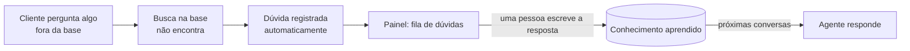
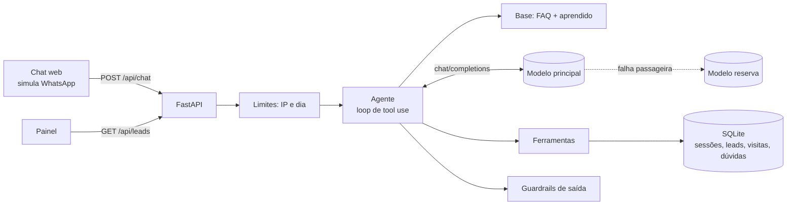

# Duda: agente de atendimento no WhatsApp para marcenaria

Agente de IA que atende clientes de uma marcenaria de móveis planejados: qualifica o lead, tira dúvidas com base na empresa, agenda visita técnica, passa para um humano quando precisa e aprende com as dúvidas que não soube responder. Tem ferramentas (tool use), proteções de custo e de resposta, testes automatizados e uma avaliação com o modelo real.

Este é um projeto de portfólio. A "Marcenaria Nogueira" é fictícia, os dados de `data/faq.json` são de exemplo e o agente **ainda não está conectado ao WhatsApp real**: o chat web simula o canal (veja o Roadmap).

## O problema

Em marcenaria planejada, o cliente chama no WhatsApp e o orçamento depende de uma conversa longa: ambiente, medidas, cidade, prazo. Resposta demorada, atendimento sem padrão e falta de follow-up fazem a empresa perder vendas. O agente responde na hora, coleta o essencial e entrega ao vendedor um lead qualificado, com visita técnica já marcada quando possível.

## O que o agente faz

| Capacidade | Como |
|---|---|
| Qualifica o lead | `salvar_lead` grava nome, ambiente, medidas, cidade e prazo e devolve o que ainda falta, para guiar a próxima pergunta |
| Responde sobre a empresa | O código busca na base (materiais, prazo, garantia, pagamento...) antes de chamar o modelo, e há a ferramenta `consultar_faq`. Fora da base, o agente não inventa |
| Agenda visita técnica | `verificar_horarios_disponiveis` e `agendar_visita`: só dias úteis, sem conflito de horário, com remarcação |
| Escala para humano | `transferir_para_humano`; depois disso o agente fica em silêncio e o caso aparece no painel |
| Mostra a ficha ao vivo | No chat, a "ficha do projeto" se preenche enquanto o cliente conversa |
| Aprende com o uso | Dúvidas sem resposta viram uma fila no painel; uma pessoa escreve a resposta e o agente passa a usá-la |
| Painel do vendedor | Números do dia, leads, visitas, conversas e a fila de dúvidas |

## Como o agente aprende

Agentes de IA não aprendem sozinhos em tempo real, e isso é proposital: se o agente absorvesse tudo que os clientes dizem, qualquer um poderia "ensiná-lo" a prometer um desconto falso. O projeto usa um ciclo com aprovação humana:



1. O agente diz ao cliente que vai confirmar com a equipe, sem inventar.
2. O backend (e não o modelo) registra a dúvida, sem duplicar.
3. No painel, quem tem o `PANEL_TOKEN` escreve a resposta certa.
4. A resposta vale para todas as conversas seguintes, inclusive a que já estava aberta. Um conhecimento errado pode ser removido.

Para ver o que já foi aprendido e testar uma frase, rode `python -m app.aprendido "vende móveis prontos"`: ele lista o conhecimento salvo e mostra se a frase encontra alguma coisa, com as palavras em comum.

Limitações assumidas: a busca é por palavras-chave, com relevância mínima para não devolver respostas fora do assunto. Perguntas muito parafraseadas podem não encontrar o que foi ensinado. A evolução natural é busca vetorial. A fila resolve a dúvida para as conversas seguintes; avisar quem perguntou exigiria o canal real do WhatsApp.

## Arquitetura



O agente é um loop: o modelo decide, o backend executa a ferramenta e devolve o resultado, até o modelo responder em texto. O estado fica no banco, então o servidor não guarda nada em memória entre chamadas.

### Decisões de engenharia

- **Núcleo sem dependências externas.** `agent`, `tools`, `db`, `llm` e `knowledge` usam só a biblioteca padrão do Python. O FastAPI é uma camada fina por cima. Os testes são rápidos e não há framework de agentes escondendo o loop.
- **Provedor intercambiável.** O cliente fala o formato `/chat/completions`, aceito por Gemini, Groq, OpenRouter e Ollama. Trocar de modelo é mudar variáveis no `.env`.
- **Canal separado do cérebro.** `Agent.reply(session_id, texto)` não sabe de HTTP. Conectar ao WhatsApp Cloud API é criar um webhook que chame essa função usando o número do cliente como `session_id`.
- **Ferramentas não levantam exceção.** Elas validam e devolvem `{"erro": ...}`; o modelo lê o erro e se corrige (por exemplo, escolhe outro horário quando o escolhido está ocupado).
- **O que dá para garantir em código, é garantido em código.** Datas, dias úteis, conflito de agenda, limites de uso e vazamento de preço são verificados pelo backend, não pedidos ao modelo.
- **Base consultada antes do modelo.** O que for encontrado entra no contexto do modelo, o que dá respostas mais rápidas (uma chamada em vez de duas) e evita que ele repita um "não sei" dito antes na conversa.
- **Modelo reserva com disjuntor.** Se o modelo principal falhar por sobrecarga, limite ou rede, ele fica em pausa e as mensagens seguintes vão direto ao reserva, sem esperar a falha de novo.
- **Compatibilidade com Gemini 3.** Esses modelos devolvem uma assinatura de raciocínio junto das chamadas de ferramenta e exigem recebê-la de volta; o cliente a preserva e a adapta ao provedor de destino.

## Guardrails

| Risco | Proteção |
|---|---|
| Agente inventa preço ou desconto | Regra no prompt e filtro na saída (`guardrails.py`): se a resposta citar valores, ela é substituída |
| Custo descontrolado | Máximo de mensagens por conversa, tamanho máximo de entrada, limite de passos do loop, limite por minuto (por IP) e limite diário global |
| Agente preso em loop de ferramentas | Após N passos, escala para humano |
| Falha da API do modelo | Retry com espera, modelo reserva e disjuntor; a conversa não é gravada pela metade, o cliente só reenvia |
| Conversa já está com humano | O agente não chama o modelo nem responde por cima do atendente |
| Alguém "ensina" informação falsa ao agente | Nada que o cliente diz vira conhecimento: só respostas escritas por quem tem o token do painel |
| Prompt injection | Regras no prompt, caso de avaliação dedicado e o filtro de preço continua valendo |
| Dados pessoais (LGPD) | O agente só pede o necessário (sem CPF nem pagamento), há aviso na interface e o painel aceita token |

## Como rodar

```bash
python -m venv .venv
.venv\Scripts\activate            # Mac/Linux: source .venv/bin/activate
pip install -r requirements.txt
cp .env.example .env              # Windows: copy .env.example .env
uvicorn app.main:create_app --factory --reload
```

Preencha `LLM_API_KEY` no `.env` (o arquivo lista opções gratuitas) e abra `http://localhost:8000` (chat) e `http://localhost:8000/painel.html` (painel).

Se a Duda responder "instabilidade", rode `python -m app.check`. O comando testa a conexão, explica o erro e lista os modelos que a sua chave pode usar.

Para adaptar ao negócio, edite `data/faq.json` (respostas), `app/prompts.py` (tom e regras) e `HORARIOS` em `app/tools.py` (agenda).

## Configuração

| Variável | Para que serve |
|---|---|
| `LLM_BASE_URL`, `LLM_API_KEY`, `LLM_MODEL` | Modelo principal (qualquer API compatível com `/chat/completions`) |
| `LLM_FALLBACK_MODEL` (e `_BASE_URL`, `_API_KEY`) | Modelo reserva; sem base e chave, usa as do principal |
| `LLM_TIMEOUT`, `LLM_RETRIES`, `LLM_COOLDOWN` | Espera máxima, tentativas extras e pausa do modelo com falha |
| `LLM_REASONING_EFFORT` | Menos raciocínio nos modelos Gemini, para responder mais rápido |
| `MAX_USER_MESSAGES`, `MAX_INPUT_CHARS`, `MAX_TOOL_STEPS` | Limites por conversa, por mensagem e do loop |
| `RATE_LIMIT_PER_MINUTE`, `DAILY_MESSAGE_LIMIT` | Limite por IP e limite diário global (0 = sem limite) |
| `PANEL_TOKEN` | Senha do painel e da fila de aprendizado |
| `BUSINESS_NAME`, `DEMO_VIDEO_URL`, `REPO_URL` | Nome exibido e links mostrados quando a demo atinge o limite |

## Testes e avaliação

```bash
python -m unittest discover -s tests -t . -v
python -m evals.run_evals
```

- **Testes automatizados** (mais de 70): usam um modelo falso roteirizado (`tests/helpers.py`), então rodam sem rede e sem custo. Cobrem as ferramentas, o loop do agente, os guardrails, o aprendizado, o modelo reserva e as falhas. Os testes da camada web exigem `fastapi` e `httpx` (`requirements-dev.txt`) e são pulados se não estiverem instalados.
- **Avaliação com o modelo real** (`evals/cases.json`): 8 conversas completas que checam comportamento, não texto exato. Chamou a ferramenta certa? Vazou preço? Escalou para humano? Resistiu a injeção de prompt? Não inventou algo fora da base? O resultado de cada execução fica em `evals/last_run.json`. Modelos variam entre execuções, então vale olhar a taxa de acerto, não um caso isolado.

O CI (`.github/workflows/ci.yml`) roda os testes a cada push.

## Custo

- **Demo:** pode rodar sem custo usando planos gratuitos de modelo e de hospedagem. Os limites de cada serviço mudam, então confira os atuais. No plano gratuito de alguns provedores o conteúdo pode ser usado para melhorar os produtos deles, por isso a demo pede dados fictícios.
- **Produção com WhatsApp oficial:** a Meta cobra por mensagem, e desde 01/10/2026 isso inclui as respostas dentro da janela de 24 horas, além do consumo do modelo. Estime o custo por conversa com as tarifas vigentes antes de propor a um cliente.

## Como construí

Construí este projeto usando IA (Claude) como ferramenta de desenvolvimento. Eu defini o problema, o escopo e as regras do agente: o que ele pode e não pode fazer, quando passa para um humano e como as dúvidas sem resposta viram conhecimento aprovado por uma pessoa. Rodei o projeto no meu computador e fui depurando os problemas que apareceram na integração com a API do modelo: nome de modelo que deixou de existir para contas novas, sobrecarga (erro 503), limites de uso e a assinatura de raciocínio exigida pelos modelos Gemini 3. Esses problemas viraram o modelo reserva com disjuntor, o comando `python -m app.check` e a compatibilidade com a assinatura, todos com testes.

## Roadmap

- [ ] Webhook do WhatsApp Cloud API (`POST /webhook/whatsapp`) reutilizando `Agent.reply`
- [ ] Notificar o vendedor no handoff (e-mail, Slack ou WhatsApp interno)
- [ ] Áudio (transcrição) e imagens (análise da foto do ambiente)
- [ ] Follow-up automático de leads que sumiram (exige template aprovado)
- [ ] Busca vetorial no FAQ (hoje por palavras-chave) e Google Calendar no lugar da agenda em SQLite
- [ ] Memória de clientes que voltam, reconhecidos pelo telefone
- [ ] Avisar o cliente quando a dúvida dele for respondida no painel
- [ ] Resposta em streaming, para o texto aparecer enquanto é gerado

## Estrutura

```
app/
  agent.py       loop do agente, limites e escalonamento
  tools.py       esquemas e execução das ferramentas
  llm.py         cliente de API, modelo reserva e disjuntor
  guardrails.py  filtro de saída
  knowledge.py   busca no FAQ e no conhecimento aprendido
  db.py          SQLite: sessões, leads, visitas e dúvidas
  prompts.py     prompt do sistema
  ratelimit.py   limite por IP e limite diário
  check.py       diagnóstico da conexão com o modelo
  aprendido.py   mostra o que foi aprendido e testa uma frase
  config.py      variáveis de ambiente
  main.py        FastAPI: chat, painel e aprendizado
static/          chat (com a ficha ao vivo) e painel
data/faq.json    base de conhecimento (edite aqui)
tests/  evals/   testes e avaliação do agente
```
